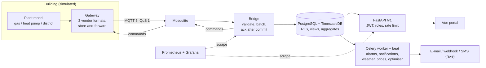

# Heatbeat

> **Kurzfassung (Deutsch):** Heatbeat ist eine herstellerunabhängige Plattform zur
> Überwachung und Optimierung von Heizungsanlagen (Gaskessel, Wärmepumpe, Fernwärme),
> getestet mit simulierten Anlagen. Gateways senden Messwerte per MQTT; eine Python-Bridge
> speichert sie verlustfrei und ohne Duplikate in PostgreSQL/TimescaleDB. Darauf bauen
> Mandantentrennung in der Datenbank, Alarmregeln mit Benachrichtigung, sichere
> Fernparametrierung (Vier-Augen-Prinzip, Audit-Trail), Optimierungsvorschläge mit
> wetterbereinigter Einsparungsschätzung, Monitoring und ein Vue-Portal auf.
> Jede Fehlersituation hat einen automatisierten Test (`docs/scenarios.md`), jede
> Architekturentscheidung ein ADR (`docs/adr/`).

**Status:** complete end-to-end; all data is **simulated**. Not affiliated with any company.

## What it does



| Part | Where | Key idea |
|---|---|---|
| Message contract | `src/heatbeat/contract.py` | Pydantic models; unknown fields ignored (forward compatible) |
| Ingest rules | `src/heatbeat/ingest.py` | Pure functions: plausibility, clock checks, sequence gaps |
| Bridge | `src/heatbeat/bridge.py`, `db.py` | Acknowledge only after the database commit; idempotent writes |
| Schema | `migrations/versions/0001`-`0006` | Hypertable, compression, retention, continuous aggregate, RLS |
| Tenants and security | `migrations/versions/0002`, `src/heatbeat/auth.py` | Row-level security + tenant-filtering views (ADR 0005) |
| API | `src/heatbeat/api/` | `/v1`, problem+json, cursor pagination, uniform 404, rate limit per tenant |
| Alarms | `alarm_rules.py`, `alarm_engine.py`, `notifier.py` | Five rule kinds, one state machine, transactional outbox (ADR 0007) |
| Remote parameters | `commands.py`, `api/command_service.py` | Version check, four-eyes, expiry, audit trail (ADR 0008) |
| Optimiser | `optimiser.py`, `optimiser_jobs.py`, `savings.py`, `external.py` | Heating curve and season advice; savings with a 95 % range |
| Scheduling | `src/heatbeat/worker.py` | Celery beat (ADR 0006) |
| Observability | `observability.py`, `monitoring/` | Metrics, JSON logs with request id, 10 alerts with runbooks |
| Simulator | `src/heatbeat/simulator.py`, `sim/` | Seeded physics-light models, fault injection, vendor adapters |
| Portal | `portal/` | Vue 3 + TypeScript, types generated from the OpenAPI file |

## Run it (Windows PowerShell; works the same on Linux/macOS)

Needs: Docker Desktop, [uv](https://docs.astral.sh/uv/), Node.js 22 (only for the portal).

**1. Settings and infrastructure**

```powershell
Copy-Item .env.example .env        # then set HB_DB_PASSWORD and HB_JWT_SECRET in .env
docker compose up -d db mqtt redis mailpit
uv sync
uv run alembic upgrade head
uv run heatbeat-seed --plants 9 --password <choose-a-demo-password>
```

The seed prints the demo users: `admin@`, `operator@` and `viewer@` for the two
customers `demo-energie.example` and `demo-wohnen.example`.

**2. The backend, one terminal each**

```powershell
uv run heatbeat-bridge
uv run heatbeat-simulator --plants 9 --backfill-hours 48 --with-faults
uv run heatbeat-api                # http://127.0.0.1:8000/docs
uv run heatbeat-worker             # alarms, notifications, optimiser (solo pool on Windows)
uv run heatbeat-beat               # the schedule for the worker
```

**3. The portal**

```powershell
cd portal
npm ci
npm run dev                        # http://127.0.0.1:5173
```

**Optional: monitoring.** `docker compose --profile monitoring up -d` starts Prometheus
(http://127.0.0.1:9090) and Grafana (http://127.0.0.1:3300, dashboard "Heatbeat overview").
For processes running outside Docker set `HB_API_HOST=0.0.0.0` so Prometheus can reach them.
Alarm e-mails arrive in Mailpit: http://127.0.0.1:8025.

**Everything in containers instead:** `docker compose --profile app up -d --build`
(portal on http://127.0.0.1:8080; demo password from `HB_DEMO_PASSWORD`).

## Tests and checks

```powershell
uv run pytest                      # 211 unit tests, no Docker needed, a few seconds
$env:HB_TEST_DATABASE_URL = "postgresql://heatbeat:<your password>@127.0.0.1:5432/heatbeat_test"
uv run pytest -m integration       # 49 tests against real TimescaleDB + Mosquitto
uv run ruff check . ; uv run ruff format --check . ; uv run mypy
cd portal; npm run typecheck; npm test; npm run test:e2e   # 10 unit + 7 browser tests
uv run python scripts/chaos.py     # S22: kill bridge, database and broker under load
```

| Layer | What | Example |
|---|---|---|
| Unit | Pure logic with fakes | Bridge never acks before commit (`test_bridge.py`) |
| Property | Hypothesis generates hundreds of inputs | Alarm never fires before the delay; a command is applied at most once |
| Fault matrix | Every plant type x every fault | Healthy plants raise no alarm; each fault raises its alarm (`test_alarm_rules.py`) |
| Integration | Real database and broker | Tenant isolation, outbox crash, command round trip over MQTT |
| Browser | Playwright + axe | Login, plant page, viewer cannot edit, accessibility |
| Contract | API docs equal the code | `docs/openapi.json` and the portal's generated types must match |
| Chaos | Real processes killed under load | 0 lost, 0 duplicated (`docs/chaos-report.md`) |
| Fitness function | Architecture rules as tests | Main query uses the index; all routes under `/v1` |

CI (`.github/workflows/ci.yml`, GitLab version in `.gitlab-ci.yml`) runs lint, strict types,
unit and integration tests, the portal checks, `promtool`, dependency audits, a secret scan
and both image builds.

## Measured (simulated data, see `docs/measurements.md`)

- One bridge: about 26,000 to 29,000 rows/s for a backlog of 50 plants.
- Storage: about 112 bytes/row uncompressed, about 7 bytes/row compressed (about 16x).
- Bridge crash, database outage, broker restart under load: 0 lost, 0 duplicates.
- API on 2 million rows: latest values about 60-90 ms, 7-day hourly series about 40 ms (`docs/query-plans.md`).

## Documentation

| File | Content |
|---|---|
| `docs/scenarios.md` | 22 failure scenarios (21 tested, 1 planned) with book references and the tests |
| `docs/adr/` | 10 architecture decisions, including the ones that changed the plan |
| `docs/security.md` | STRIDE threat model, controls, known gaps |
| `docs/operations.md` | SLOs, alerts and a runbook per alert |
| `docs/measurements.md`, `docs/chaos-report.md`, `docs/query-plans.md` | Numbers and how to reproduce them |
| `docs/openapi.json` | API description (generated: `uv run heatbeat-openapi`) |

## Known limits (next steps)

- Broker without TLS and per-gateway credentials (development config; see `docs/security.md`).
- Bridge and workers use the table owner role, not a least-privilege role.
- Login issues tokens itself (no SSO, refresh tokens or revocation; ADR 0009).
- Gateways and plants are simulated; no real Modbus or vendor cloud is connected.
- Savings are estimated on simulated data with a known effect; real buildings need a longer baseline.
- One device-clock case is still open (S05: a clock that jumps backwards).
