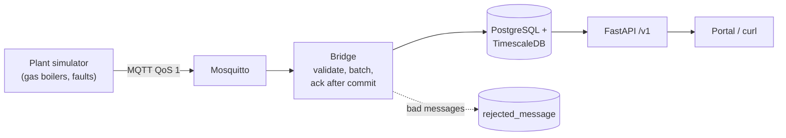

# Heatbeat

> **Kurzfassung (Deutsch):** Heatbeat ist eine herstellerunabhängige Plattform zur
> Überwachung von Heizungsanlagen, getestet mit simulierten Anlagen. Gateways senden
> Messwerte per MQTT; eine Python-Bridge speichert sie verlustfrei und ohne Duplikate
> in PostgreSQL/TimescaleDB; eine versionierte REST-API (FastAPI) liefert Anlagen,
> aktuelle Werte und Zeitreihen. Jede Fehlersituation hat einen automatisierten Test
> (siehe `docs/scenarios.md`), jede Architekturentscheidung ein ADR (`docs/adr/`).

**Status:** core pipeline working and tested (ingest, storage, API, alarm logic).
Data is simulated. Not affiliated with any company.

## What it does



| Part | File | Key idea |
|---|---|---|
| Message contract | `src/heatbeat/contract.py` | Pydantic models; unknown fields ignored (forward compatible) |
| Ingest rules | `src/heatbeat/ingest.py` | Pure functions: plausibility, clock checks, sequence gaps |
| Bridge | `src/heatbeat/bridge.py` | Acknowledge only after the database commit |
| Database writer | `src/heatbeat/db.py` | One transaction per batch, `ON CONFLICT DO NOTHING` |
| Schema | `migrations/versions/0001_initial_schema.py` | Narrow hypertable, compression, retention, continuous aggregate |
| API | `src/heatbeat/api/` | `/v1`, cursor pagination, `application/problem+json`, query limits |
| Alarm logic | `src/heatbeat/alarms.py` | State machine with property-based tests |
| Simulator | `src/heatbeat/simulator.py` | Seeded, with fault injection |

## Run it (Windows PowerShell; works the same on Linux/macOS)

Needs: Docker Desktop, [uv](https://docs.astral.sh/uv/).

```powershell
Copy-Item .env.example .env        # then open .env and set HB_DB_PASSWORD
docker compose up -d db mqtt       # database + broker
uv sync                            # install exact versions from uv.lock
uv run alembic upgrade head        # create tables
```

Then, in three terminals:

```powershell
uv run heatbeat-bridge
uv run heatbeat-simulator --plants 5 --backfill-hours 6 --with-faults
uv run heatbeat-api                # open http://localhost:8000/docs
```

Or everything in containers: `docker compose --profile app up -d --build`

## Tests and checks

```powershell
uv run pytest                      # 77 unit tests, no Docker needed, about 2 s
$env:HB_TEST_DATABASE_URL = "postgresql://heatbeat:<your password>@127.0.0.1:5432/heatbeat_test"
uv run pytest -m integration       # 13 tests against real TimescaleDB + Mosquitto
uv run ruff check . ; uv run ruff format --check . ; uv run mypy
```

| Layer | What | Example |
|---|---|---|
| Unit | Pure logic with fakes | Bridge never acks before commit (`test_bridge.py`) |
| Property | Hypothesis generates hundreds of inputs | Alarm never fires before the delay (`test_alarms.py`) |
| Integration | Real database and broker | Kill the DB connection mid-ingest: no loss, no duplicates |
| Contract | API docs equal the code | `docs/openapi.json` must be regenerated (`test_openapi.py`) |
| Fitness function | Architecture rules as tests | Main query must use the index; all routes under `/v1` |

CI (`.github/workflows/ci.yml`, GitLab version in `.gitlab-ci.yml`) runs lint, strict
types, unit and integration tests, a dependency audit, a secret scan and the image build.

## Measured (simulated data, see docs/measurements.md)

- One bridge: about 26,000 to 29,000 rows/s for a 6-hour backlog of 50 plants (target: 4,000 rows/s).
- Storage: about 112 bytes/row uncompressed, about 7 bytes/row compressed (about 16x).
- Database stopped during ingest: 0 rows lost, 0 duplicates.

## Documentation

- `docs/scenarios.md`: failure scenarios, book references, and the tests that prove them
- `docs/adr/`: architecture decisions (narrow table, ack after commit, no Kafka, sync Python)
- `docs/openapi.json`: versioned API description (generated: `uv run heatbeat-openapi`)
- `.github/ISSUE_TEMPLATE/task.md`, `.github/pull_request_template.md`: ticket and definition of done

## Known limits (next steps)

- No authentication or tenants yet (planned: JWT + PostgreSQL row-level security).
- Broker allows anonymous clients (development only; production needs TLS, per-gateway credentials, ACLs).
- Alarm state machine exists and is tested, but is not yet scheduled (planned: Celery beat + outbox for notifications).
- No remote parameter changes yet (planned: command pipeline with expiry and audit trail).
